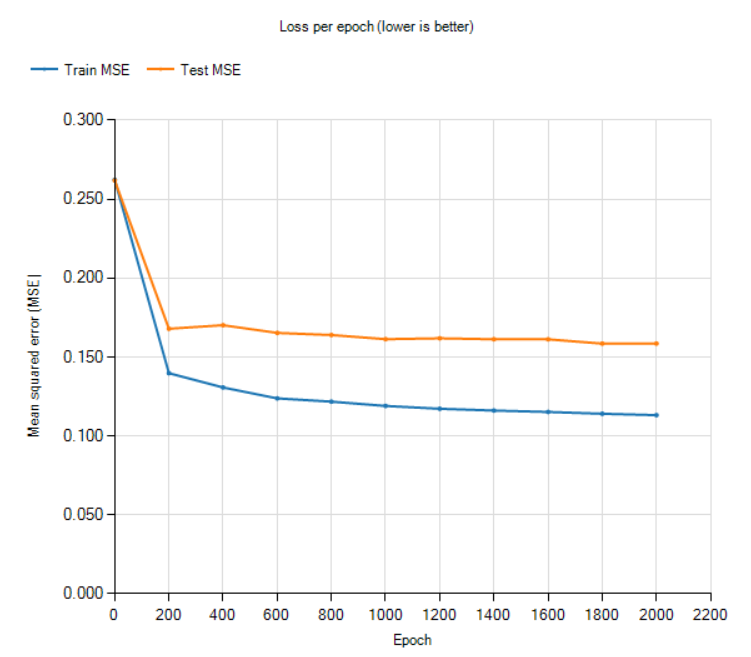

# Maternal Health Risk Predictor (Backpropagation NN)

A Windows Forms app that trains a neural network to classify a pregnant patient's risk level
(**low / mid / high**) from six vital signs. It uses the professor's C# backpropagation engine
(`NeuralNet`, `INeuron`, `HNeuron`, `ONeuron`) **unchanged**: the app only prepares the data, calls the
engine, and measures the results.

- **Track:** multi-class classification
- **Dataset:** UCI Maternal Health Risk (`Maternal_Health_Risk_Data_Set.csv`, included in the repo)
- **Network:** 6 inputs → H hidden → 3 outputs (sigmoid), one-hot targets, ArgMax prediction

## Requirements

- Windows 10 or 11
- Visual Studio 2022 (17.13 or later) or Visual Studio 2026, with the **.NET desktop development** workload
- .NET Framework **4.8** (installed with that workload)

No NuGet packages are needed. The chart uses `System.Windows.Forms.DataVisualization`, which is part of
.NET Framework 4.8.

## How to run

1. Clone the repository:
   ```
   git clone https://github.com/kworuu/maternal-risk-predictor-mlp.git
   ```
2. Open `MaternalRiskPredictor.slnx` in Visual Studio.
3. Press **F5** (or **Debug → Start Debugging**). Visual Studio builds the project and copies the CSV next
   to the `.exe`.
4. In the app, follow the numbered panels on the left from top to bottom:

| Step | Click | What happens |
|---|---|---|
| 1 | **Load CSV…** | Opens the dataset (the file dialog starts in the right folder). The **Data** tab shows the raw rows, with duplicates greyed out and impossible values in red. |
| 2 | **Clean + Split + Normalize** | Removes duplicates and impossible heart rates, makes a stratified 80/20 split, and scales every feature to [0, 1] using the training set's min/max. Every step is written to the **Training Log**. |
| 3 | **Create NN** | Builds a 6-H-3 network with random weights (H = *Hidden nodes*). |
| 4 | **Train NN** | Trains for *Epochs* epochs in the background. The log shows train/test MSE and accuracy every *Log every N* epochs, and the **Loss curve** tab draws them live. **Stop** ends training early. Clicking Train again continues from the current weights. |
| 5 | **Evaluate on test set** | The **Evaluation** tab shows test accuracy, the majority-class baseline, the confusion matrix and precision/recall/F1 per class. |
| 6 | **Export loss log (CSV)…** | Saves `training_log.csv` (epoch, train/test MSE, train/test accuracy). |
| 7 | **Run NN** (panel 4) | Type one patient's raw vitals to get a predicted risk. The log shows the scaled inputs and all 3 outputs. |
| 8 | **Tuning** tab → **Run grid search** | Trains several networks for every combination of hidden sizes × epoch counts and reports the mean ± std test accuracy. The best row is highlighted. |

**Settings used for the results below:** Training % 80, Split seed 1, all three cleaning options
ticked, 4 hidden nodes, 2000 epochs.

## Project structure

| File | Contents |
|---|---|
| `BackNeural.cs`, `InputN.cs`, `HiddenN.cs`, `OuputN.cs` | The professor's backpropagation engine (namespace `Backprop`), **not modified** |
| `MaternalData.cs` | `Patient` class, CSV loading, class names, duplicate and impossible-value checks |
| `Preprocessing.cs` | Duplicate removal, stratified train/test split, `MinMaxScaler` |
| `NetworkTrainer.cs` | Wraps `NeuralNet`: one-hot targets, training one epoch, prediction, MSE and accuracy |
| `Metrics.cs` | `ConfusionMatrix` (precision, recall, F1, macro average) and the majority-class baseline |
| `Tuning.cs` | Grid-search settings, results, and mean/std helpers |
| `Form1.cs` | Window setup and shared helpers (log, status bar, busy state) |
| `Form1.Data.cs` | Load / clean / split / normalize buttons and the Data tab |
| `Form1.model.cs` | Create, train, stop, loss chart, export, evaluation, single prediction and tuning |
| `Form1.Designer.cs` | Layout generated by the Visual Studio designer |
| `Maternal_Health_Risk_Data_Set.csv` | The dataset |
| `training_log.csv` | Training log of the final model (exported from the app) |
| `docs/` | Screenshots used in this README |

## Data description

**Source:** Ahmed, M. (2020). *Maternal Health Risk* [Dataset]. UCI Machine Learning Repository.
https://doi.org/10.24432/C5DP5D (CC BY 4.0). Records of pregnant women collected from hospitals and
community clinics in rural Bangladesh.

**Size:** 1,014 rows, 6 numeric features and 1 label, no missing values.

| Feature | Meaning | Unit |
|---|---|---|
| Age | Age of the patient | years |
| SystolicBP | Upper blood pressure value | mmHg |
| DiastolicBP | Lower blood pressure value | mmHg |
| BS | Blood sugar (glucose) | mmol/L |
| BodyTemp | Body temperature | °F |
| HeartRate | Resting heart rate | beats per minute |

**Label (`RiskLevel`):** `low risk`, `mid risk` or `high risk`, encoded as classes 0, 1 and 2.

| Class | Rows (raw) | Rows (after cleaning) |
|---|---:|---:|
| Low risk | 406 | 233 |
| Mid risk | 336 | 106 |
| High risk | 272 | 112 |
| **Total** | **1,014** | **451** |

**Data-quality findings** (shown in the app's Training Log and the Data tab's Raw view):
- **562 rows (55%) are exact duplicates** of an earlier row (same 6 values and the same label).
- **2 rows (500 and 909) have a heart rate below 40 bpm**, which isn't realistic for a resting adult,
  so we treat them as entry errors. Row 909 is also a duplicate.
- **35 sets of identical vital signs appear with different risk labels.** Cleaning can't resolve
  these, so they limit how accurate any model can be.

## Preprocessing

All steps run when you click **Clean + Split + Normalize**. Each checkbox can be switched off to see
its effect, and every step is written to the Training Log.

1. **Remove duplicates (before splitting).** 1,014 → 452 rows. Doing this first means no patient can
   appear in both the training and the test set. Otherwise the test score would partly measure
   memorisation (data leakage). The log confirms it with *"Test rows that are exact copies of a
   training row: 0"*. Untick the box to see that count rise.
2. **Remove impossible values.** Heart rate below 40 bpm: 452 → 451 rows.
3. **Stratified 80/20 split, seed 1.** Each risk level is shuffled and split separately, so both sets
   keep the same class proportions: **361 training rows** (186 / 85 / 90) and **90 test rows**
   (47 / 21 / 22). The seed makes the split reproducible.
4. **Min-max scaling to [0, 1].** `x' = (x − min) / (max − min)`, with min and max taken **from the
   training set only** and reused for the test set and for single-patient predictions. This matches
   the sigmoid's 0–1 range, and it keeps features with large numbers (blood pressure) from drowning
   out small ones (blood sugar). Test values may fall slightly outside [0, 1]; that's expected.
5. **One-hot targets.** Low = `1 0 0`, Mid = `0 1 0`, High = `0 0 1`, one output neuron per class.

The **Data** tab shows each stage: **Raw** (duplicates grey, impossible values red), **Cleaned**
(train/test split in original units, test rows blue) and **Scaled** (what the network receives).

## Results and analysis

All numbers below come from the app itself, run on the cleaned data (451 unique patients) with the
stratified 80/20 split, **split seed 1** (361 training rows, 90 test rows). The network is the
professor's backpropagation engine (`NeuralNet`, sigmoid activations, learning rates fixed at 0.2 for
the output layer and 0.15 for the hidden layer), used without changes.

### 1. Training: the loss goes down



*Final model: 6 inputs, 4 hidden nodes, 3 outputs, 2000 epochs. The full per-epoch log is in
[`training_log.csv`](training_log.csv) (exported with **Export loss log (CSV)**).*

| Epoch | Train MSE | Test MSE |
|---:|---:|---:|
| 0 (random weights) | 0.262 | 0.262 |
| 200 | 0.140 | 0.168 |
| 1000 | 0.119 | 0.161 |
| 2000 | 0.113 | 0.158 |

- **Backpropagation works.** Training MSE falls from 0.262 to 0.113 (−57%). Most of the drop happens in
  the first 200 epochs, when the random weights are far from good and every `learn()` call makes large
  corrections. After that the errors are small, so the updates are small and the curve flattens.
- **The test loss stops improving early.** It drops with the training loss up to about epoch 200, then
  only creeps from 0.168 to 0.158 while the training loss keeps falling. The widening gap is mild
  overfitting: the extra epochs mostly fit the 361 training rows more closely and help the unseen test
  rows very little.

### 2. Tuning: hidden nodes × epochs

The **Tuning** tab trained a fresh network **5 times** for every setting (new random weights and a new
shuffle order each time, same split) and reports the mean test accuracy ± standard deviation over the
5 runs. Each network was trained once to 2000 epochs and measured at every listed epoch.

| Hidden \ Epochs | 10 | 50 | 100 | 500 | 1000 | 2000 |
|---|---:|---:|---:|---:|---:|---:|
| **2** | 55.1 ± 3.0 | 64.4 ± 0.0 | 62.7 ± 1.7 | 62.7 ± 1.3 | 62.9 ± 2.0 | 63.3 ± 1.1 |
| **4** | 60.7 ± 2.3 | 63.8 ± 1.0 | 61.3 ± 1.4 | 67.1 ± 1.7 | 68.0 ± 1.8 | **69.8 ± 2.1** |
| **6** | 61.1 ± 0.8 | 63.6 ± 1.4 | 62.0 ± 1.4 | 67.8 ± 1.4 | 69.6 ± 1.0 | 68.7 ± 0.9 |
| **8** | 61.6 ± 1.0 | 64.0 ± 0.6 | 61.3 ± 1.4 | 68.0 ± 2.8 | 67.6 ± 1.4 | 68.2 ± 2.7 |

*Test accuracy in %, mean ± std over 5 runs. Train accuracy at 2000 epochs: 72.1% (2 hidden),
75.8% (4), 76.9% (6), 78.3% (8).*

**What the grid shows**

- **Chosen setting: 4 hidden nodes, 2000 epochs** (69.8% ± 2.1%), the highest mean. It is
  **effectively tied** with 6 hidden / 1000 epochs (69.6% ± 1.0%) and with most settings that have
  4–8 hidden nodes and 500+ epochs (67–70%). The differences between them are smaller than the
  run-to-run spread, so the honest conclusion is that **once the network has at least 4 hidden nodes
  and 500 epochs, its size hardly matters**. We kept the smallest network among the top settings.
- **2 hidden nodes is too small (underfitting).** It levels off at about 63% no matter how long it
  trains, and even its training accuracy stays at about 72%. Two hidden neurons cannot separate three
  classes well.
- **More hidden nodes means more overfitting.** Training accuracy keeps rising with size (75.8% → 78.3%
  at 2000 epochs) while test accuracy does not, so the extra capacity memorises training rows instead
  of learning anything that carries over to new patients.
- **Epochs matter more than size.** Every network gains about 6–9 points between 10 and 500 epochs.
  The small dip at 100 epochs, compared with 50, shows up for every size, so it is a phase of training
  rather than noise from one run.
- **Why repeated runs:** the engine starts from random weights, so the same setting can score a few
  points differently from one run to the next. With one run per setting, the "best" row would largely
  be luck.

### 3. Evaluation of the final model on the test set

| | |
|---|---|
| **Test accuracy** | **67.8%** (61 of 90 correct) |
| Train accuracy | 77.0% |
| Majority-class baseline (always answer "Low risk") | 52.2% |

This single training run scored 67.8%, inside the 69.8% ± 2.1% range the tuning predicted for the
setting. It beats the baseline by **15.6 percentage points**, so the network has learned real patterns
from the vitals and is not just repeating the most common class.

**Confusion matrix** (rows = actual risk, columns = predicted risk)

| Actual \ Predicted | Low | Mid | High | Total |
|---|---:|---:|---:|---:|
| **Low** | **43** | 3 | 1 | 47 |
| **Mid** | 11 | **5** | 5 | 21 |
| **High** | 3 | 6 | **13** | 22 |
| **Total predicted** | 57 | 14 | 19 | 90 |

**Per-class metrics**

| Class | Precision | Recall | F1 | Support |
|---|---:|---:|---:|---:|
| Low risk | 0.754 | 0.915 | 0.827 | 47 |
| Mid risk | 0.357 | 0.238 | 0.286 | 21 |
| High risk | 0.684 | 0.591 | 0.634 | 22 |
| **Macro average** | **0.599** | **0.581** | **0.582** | 90 |

**Reading the results**

- **Low risk is learned well** (recall 0.915: 43 of 47 found). It is the largest class (52% of the
  data) and has the most typical vitals: normal blood pressure and blood sugar.
- **Mid risk is the weak point** (recall 0.238: only 5 of 21 found). Its vitals sit between the other
  two classes, so 11 mid-risk patients were called Low and 5 were called High. Two facts from the data
  explain this. First, mid risk is the smallest class after cleaning (106 rows). Second, the data
  contains **35 sets of identical vitals that carry different risk labels**, so no model could
  classify all of those rows correctly.
- **High risk: 13 of 22 found (recall 0.591).** In a medical setting this is the number that matters
  most, because a missed high-risk mother is the dangerous mistake. 6 high-risk patients were called
  Mid, which is a partial miss, but **3 were called Low risk, which is the most serious error** in the
  matrix. Only 1 low-risk patient was flagged as High, so the model leans towards under-warning rather
  than over-warning.
- **The macro average (F1 0.582) is lower than the accuracy (67.8%)** because it gives the small Mid
  class as much weight as Low. The accuracy is pulled up by the large, easy Low class.

### 4. Limitations

- **The test set is small.** With 90 test rows, one patient is 1.1 percentage points, so differences
  of 1–2 points between settings are not meaningful.
- **Settings were chosen on the test set.** We picked the best setting by its test accuracy, so the
  reported score is slightly optimistic. A stricter setup would tune on a separate validation split (or
  use cross-validation) and touch the test set only once. With only 451 unique rows we kept a plain
  80/20 split and state this openly.
- **The engine's learning rates are fixed** (0.2 / 0.15, `const` in `BackNeural.cs`). Since the
  activity requires using the given classes unchanged, learning rate could not be tuned, only hidden
  nodes and epochs.
- **Duplicates.** 562 of the 1,014 original rows were exact copies. We removed them **before**
  splitting so no test row also appears in training. With duplicates kept, test accuracy would look
  higher, but it would partly measure memorisation. (See the Preprocessing section.)
- **Not a medical tool.** This is a class exercise on a small public dataset. Its 59% recall for high
  risk is far below what a real screening tool would need.

### 5. How to reproduce these numbers

1. **Load CSV** → `Maternal_Health_Risk_Data_Set.csv`.
2. Keep Training % **80**, Split seed **1**, and all three checkboxes ticked, then click
   **Clean + Split + Normalize**.
3. **Tuning tab:** Hidden sizes `2, 4, 6, 8`, Epoch counts `10, 50, 100, 500, 1000, 2000`, Runs per
   config `5` → **Run grid search**.
4. **Final model:** Hidden nodes **4**, Epochs **2000** → **Create NN** → **Train NN** →
   **Evaluate on test set** → **Export loss log (CSV)**.

The engine's random starting weights are not seeded, so your numbers will differ slightly from run to
run (typically within the ± std shown in the tuning table). The split itself is fixed by the seed.
